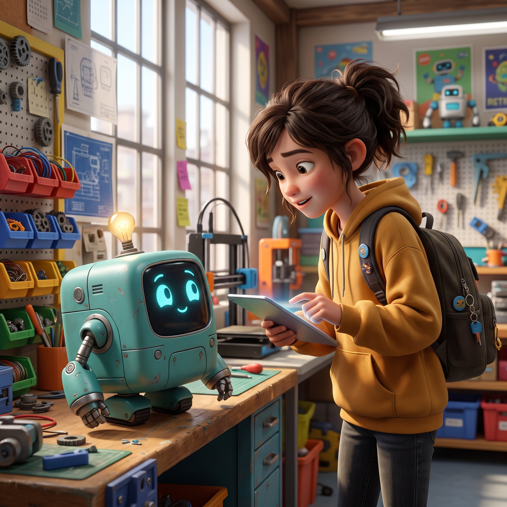

# «Первые шаги в ИИ» — анимированные презентации для 5–8 классов

Две видеопрезентации на одном движке **Remotion (React+TS)** + быстрый тракт **FFmpeg (Pillow+MoviePy)**. Для школьников 11–14 лет, без жаргона, 1 идея — 1 сцена — 1 метафора.



> **Ветка `arena/750486c0-ai-first-steps` самодостаточна** — `main` не нужен. Клонируй её: `git clone --branch arena/750486c0-ai-first-steps https://github.com/Ovladimirovich/ai-first-steps.git`

---

## 📚 Документация подробно — `docs/`

| Документ | О чём |
|---|---|
| [docs/00_INDEX.md](docs/00_INDEX.md) | Навигация |
| [docs/01_OVERVIEW.md](docs/01_OVERVIEW.md) | Две презентации, аудитории, результаты 11:45 и 6:19 |
| [docs/02_QUICKSTART_WINDOWS.md](docs/02_QUICKSTART_WINDOWS.md) | **От пустой папки до MP4 на Windows 10/11** (самая подробная) |
| [docs/03_GITHUB_ACTIONS.md](docs/03_GITHUB_ACTIONS.md) | Облачный рендер бесплатно (Remotion 60 мин / FFmpeg 4 мин) |
| [docs/04_ARCHITECTURE.md](docs/04_ARCHITECTURE.md) | Структура репозитория, поток `lines → timing → voice → render` |
| [docs/05_PIPELINES.md](docs/05_PIPELINES.md) | Remotion vs FFmpeg — скорость 50 мин vs 3-5 мин, когда что брать |
| [docs/06_PIXAR_SCENES.md](docs/06_PIXAR_SCENES.md) | 25 Pixar-сцен «Зачем ИИ школьнику» 379с |
| [docs/07_TIMELINE_VOICE.md](docs/07_TIMELINE_VOICE.md) | Таймлайн, озвучка 57 реплик, субтитры |
| [docs/08_TROUBLESHOOTING.md](docs/08_TROUBLESHOOTING.md) | Node 24, No browser, OOM, антивирус |

Короткие старты: [README_PIXAR.md](README_PIXAR.md) — Pixar-версия, этот файл — оригинал.

---

## Результаты

| Файл | Что |
|---|---|
| `release/final.mp4` 1080p 30fps H.264 CRF26 52МБ | Оригинал «Первые шаги» 30 сцен 11:45 с субтитрами |
| `release/final_nosubs_720p.mp4` + `subtitles/ru.srt` | Оригинал без субтитров |
| `preview/pixar-why-ai-preview.mp4` 7.8МБ 6:18 | Pixar превью (уже готов, FFmpeg цвет+voice+subs) |
| `preview/pixar-why-ai-ffmpeg.mp4` 26МБ 6:19 1920×1080 | Pixar финал FFmpeg (3-5 мин, Pillow+MoviePy) |
| `release/pixar-why-ai-full.mp4` ~300МБ | Pixar финал Remotion (50 мин, Chrome) |
| `script/scenario.md` + `.docx`, `scenario_why_ai_pixar.md` | Сценарии |
| `script/factcheck.md` | Проверка фактов |
| `storyboard/storyboard.pdf` | Раскадровки |
| `credits.md` | Лицензии, дата актуальности 27.10.2026 |

В репозитории только исходники (~15МБ). `release/` генерится и в `.gitignore`.

---

## Как пересобрать — кратко

### Оригинал 11:45
```bash
pip install imageio-ffmpeg numpy
python tools/build_timeline.py   # → timing.json + voice_track.mp3 + ru.srt
cd remotion && npm i && npx remotion browser ensure
npm run dev                      # Studio http://localhost:3000
npm run render                   # → ../release/final.mp4
```

### Pixar 6:19 — Remotion (красиво)
```bash
cd remotion && npm i && npx remotion browser ensure
npx remotion render src/index.ts PixarWhyAI ../release/pixar-why-ai-full.mp4 --codec h264 --crf 18 --concurrency 4
```

### Pixar 6:19 — FFmpeg (быстро, рекомендуется)
```bash
pip install Pillow moviepy==1.0.3 imageio-ffmpeg
python tools/build_ffmpeg_video.py --output release/pixar-why-ai-ffmpeg.mp4 --crf 18 --preset medium
# 720p за 1 мин:
python tools/build_ffmpeg_video.py --preview --output preview/pixar-why-ai-ffmpeg-preview.mp4
```

Границы сцен считаются из таймкодов — поправил реплику → всё сместится.

Подробно с нуля на Windows — [docs/02_QUICKSTART_WINDOWS.md](docs/02_QUICKSTART_WINDOWS.md). Облако — [docs/03_GITHUB_ACTIONS.md](docs/03_GITHUB_ACTIONS.md).

---

## Структура

```
ai-first-steps/
├── remotion/src/scenes/      # 30 сцен оригинала S0_1…S8_2
├── remotion/src/pixarScenes/ # 25 сцен Pixar PS0_1…PS8_2
├── remotion/src/components/  # Card, Characters, PixarCard, PixarCharacters
├── assets/audio/voice*       # 85 + 57 mp3
├── remotion/public/timing*.json + audio/voice_track*.mp3
├── script/lines*.json        # 85 и 57 реплик — единый источник
├── tools/build_*.py          # таймлайны + FFmpeg видео
├── preview/                  # превью (коммитятся)
├── release/                  # финалы (игнор)
└── docs/                     # подробная документация
```

Подробнее — [docs/04_ARCHITECTURE.md](docs/04_ARCHITECTURE.md).

---

## Как заменить реплику

1. Правь `script/scenario*.md` и `script/lines*.json`
2. Перезапиши `assets/audio/voice*/<id>.mp3`
3. `python tools/build_timeline.py` или `tools/build_pixar_real_timeline.py`
4. `python tools/build_ffmpeg_video.py` (3 мин) или `npx remotion render` (50 мин)

См. [docs/07_TIMELINE_VOICE.md](docs/07_TIMELINE_VOICE.md).

---

## Чек-лист перед показом

- [ ] Фактчек блока 4 (сервисы обновляются 1-3 мес), обнови дату в `S8_2.tsx` и `credits.md`
- [ ] Прогон на 5–8 классе — 4 мысли пересказывают без подсказки
- [ ] Громкость на школьной акустике (`-16 LUFS`, музыка `-22 dB`)

---

## Лицензии

Код `remotion/`, `tools/` — **MIT** (`LICENSE`). Музыка/voice сгенерированные — **CC0**. SVG персонажей — **CC BY-NC 4.0**. Шрифты — **OFL**. Товарные знаки ChatGPT/Алиса/GigaChat — владельцев. Полно — `credits.md` + [docs/01_OVERVIEW.md](docs/01_OVERVIEW.md).
